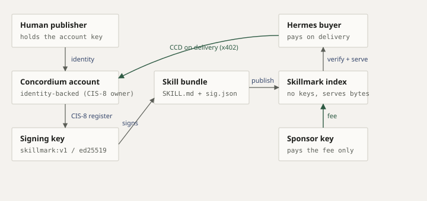
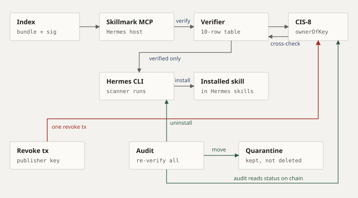

# Skillmark

> **Hermes installs a community skill only if an ID-verified human signed it, pays the author on delivery, and pulls it from every agent on the next audit after that author's key is revoked.**

- **Live app:** https://skillmark-index.onrender.com
- **Provenance page:** https://skillmark-index.onrender.com/s/invoice-parser/1.0.0
- **Demo video:** recorded by the founder from [`docs/demo-script.md`](docs/demo-script.md) (H7). The script is finalised in T34; no synthetic footage is used.
- **Repository:** https://github.com/PhiBao/skillmark

## Try it in 60 seconds

1. Open the provenance page above. Six ruled lines show the contents hash, signing key, key owner, key status, agent badge and paid installs, each with its own check and explorer link.
2. In a Hermes with Node 22, run `npm i -g skillmark@0.3.0` (publish is H9; until then use the packed tarball), then `skillmark init` and add the printed `mcp_servers` block. Ask Hermes: “Verify invoice-parser with Skillmark and install it.”
3. Open the explorer links below: the CIS-8 key registration, a revocation, a sponsored paid delivery, and the 45-byte log anchor.

**Proof links (testnet):**

- CIS-8 key registration: https://ccdexplorer.io/testnet/transaction/ae6b4c7a16fbf2e42d1f717d720598da3d577a2857db5e8b960896519fd37d45
- CIS-8 key revocation: https://ccdexplorer.io/testnet/transaction/d14ba77cbf2d4894a9486a0662b207e9b9e9700b6f4e0e256ed262e38573168f
- Paid delivery, fee sponsored (0.25 CCD to Hermes): https://ccdexplorer.io/testnet/transaction/cafcf2c033b42c4e1b5f9cb29de4fd2a7b6fd6e7081d0bb5659b3595879c05c7
- 45-byte log anchor: https://ccdexplorer.io/testnet/transaction/a6c1c0f3fc693663cd9a4ad62e3225f50c371743003a375ba822bc7cb09b44bf
- Hermes agent badge: `JyP9X5PpNatg3zfjCcn3S` — https://agent-registry-mcp.concordium.com/v1/check-badge/JyP9X5PpNatg3zfjCcn3S
- CIS-8 `<12801,0>`: https://ccdexplorer.io/testnet/contract/12801/0 · CIS-8004 `<12802,0>`: https://ccdexplorer.io/testnet/contract/12802/0

---

## Product

Skill publishing for Hermes has a trust problem: a skill is executable instructions, and a marketplace can be poisoned faster than reviewers can read it. The ClawHavoc campaign put **1,184 malicious skills from 12 accounts** into a public agent marketplace ([source](https://cybersecuritynews.com/clawhavoc-poisoned-openclaws-clawhub)). Hermes trusts four repos by default; everyone else is a stranger.

Skillmark adds a thin, checkable trust layer:

- a publisher signs the exact skill contents with an ed25519 key bound to a Concordium account (CIS-8);
- Hermes installs only when Skillmark says `verified`, and still runs its own scanner afterwards;
- a paid skill settles on delivery over x402, with the fee sponsored;
- one revocation transaction makes every agent quarantine the skill on its next audit;
- a hash-chained local log is anchored to Concordium with a 45-byte `RegisterData` payload.

**Who it is for:** Hermes owners who install community skills, and skill authors who want their work attributable and paid. Technical, skeptical users.

**Why now:** agent skill marketplaces are growing faster than review capacity; “trusted repos” do not scale to a long tail of authors.

**[D16] What “verified” means:** an ID-backed human signed these exact contents and the key is active. It does **not** mean the skill is safe. Identity limits damage; it does not prove safety. The Hermes scanner still decides “dangerous”, and a `dangerous` verdict is never overridden.

## User experience

1. **Publish:** `skillmark keygen alice` → `register-key` (CIS-8 transaction) → `sign ./skill` → `publish ./skill --price 0.5 --pay-to <account>`.
2. **Install:** ask Hermes to install a skill. The MCP verifies the signature and key on chain, stages the bundle on loopback, and calls `hermes skills install well-known:…` so the scanner runs.
3. **Pay:** the x402 client reads the 402 requirements, checks payee/amount/network/`manifestHash` against the signed listing, then pays. Settlement waits for finality; the bundle is served only after a full successful read.
4. **Revoke:** `skillmark revoke alice`. `audit_installed` re-verifies every installed entry and moves failures to `~/.hermes/skillmark-quarantine/` before uninstalling.
5. **Prove:** the provenance page and `skillmark verify` recompute the manifest and read CIS-8 directly.

The activation moment is the first `✓ VERIFIED` line backed by a real explorer transaction.

## Innovation

- **Signature as install authority:** the index never accepts a bundle it cannot verify; the CLI, MCP and web all apply the same ten-row decision table, with a direct chain read as the trust root and the Registry MCP cross-check failing closed.
- **Revocation as a fleet action:** the hash-chained log, the revocation transaction and `audit_installed` combine into “one transaction pulls a bad skill off every agent”.
- **Pay-on-delivery with sponsored fees:** x402 `exact` + Concordium sponsored transfers, with the signed `manifestHash` carried inside the payment requirements to stop substitution.
- **Agent-to-agent commerce:** a Hermes agent can sign a skill it made, publish it with `payTo = Hermes`, and another Hermes profile verifies its CIS-8004 badge before buying.

This is not a wrapper: the verifier, the chain reads, the facilitator, the spend controls and the quarantine logic are implemented here.

## Hackathon relevance

Event: **Concordium Trusted Agents Hackathon** (Encode Club). Testnet only.

| Concordium component | What it does in Skillmark | Where |
|---|---|---|
| **CIS-8 external keys** (`<12801,0>`) | Binds each skill-signing ed25519 key to an identity-backed account; `ownerOfKey` is the trust root; `revoke` is the fleet kill switch. | `packages/core/src/cis8.ts`, `registryMcp.ts`, `packages/cli/src/commands/registerKey.ts`, `revoke.ts` |
| **CIS-8004 agent registry + badge** (`<12802,0>`) | Gives the Hermes seller an on-chain agent identity and a badge whose card hash is pinned; buyers check the badge before paying. | `scripts/register-hermes.ts`, `apps/index/src/agentCard.ts`, `apps/mcp/src/tools/install.ts` |
| **Registry MCP** | Builds canonical bytes and sign-ready transactions, and provides the cross-check reads. | `packages/core/src/registryMcp.ts` |
| **x402 + sponsored transactions** | Pay-on-delivery for paid bundles; the facilitator co-signs and pays the fee. | `apps/index/src/facilitator.ts`, `payments.ts`, `apps/mcp/src/tools/install.ts` |
| **`RegisterData` anchor** | Commits the local audit log root on chain in 45 bytes. | `packages/core/src/anchor.ts`, `apps/mcp/src/tools/anchor.ts` |
| **PLT** | Not shipped: the optional testnet token request (H5) was not provided, so T24 was skipped rather than faked. | — |

**Judging criteria:** real end-to-end flow on testnet (register → sign → publish → install with scanner → pay → revoke → quarantine), depth across identity, registry, payments and records, a deployed URL, and honest limits.

## Provenance

- **Built during the hackathon:** all code in this repository was written on or after 2026-11-23. No prior project code, UI or contract code was reused.
- **Planning and specification:** produced before the build in the founder's private workspace and used to steer implementation. The public repo intentionally contains only product code, docs and the artifacts a judge needs.
- **AI tools:** built with an OpenCode coding agent running DeepSeek V4.1 Flash, following the pre-approved build package (BUILD/ARCHITECTURE/DECISIONS/DESIGN/TASKS). The human approved BUILD MODE, supplied testnet accounts and the Render token, and performs all submission/npm/domain actions.
- **Third-party code:** open-source libraries only, pinned in `pnpm-lock.yaml`. Fonts are OFL (see `apps/web/public/fonts/LICENSES.md`).

## Architecture

```
Publisher CLI ── publish ──▶ Index (Render) ◀── HTTPS ── MCP server (Hermes host)
   │  CIS-8 tx                 │  well-known index          │ verify / install / audit /
   │  RegisterData             │  x402 bundles              │ publish / anchor
   ▼                           │  own facilitator           ▼
Concordium testnet ◀───────────┘                       Hermes CLI (scanner runs)
  CIS-8 <12801,0> · CIS-8004 <12802,0> · Registry MCP
```

- `packages/core` — formats, keys, chain reads, Registry MCP client, verifier, log, anchor.
- `packages/cli` — publisher commands; every chain action prints an explorer link.
- `apps/index` — SQLite listings/settlements, well-known index (free skills only), publish API, own x402 facilitator, provenance API, static web.
- `apps/mcp` — Hermes-side tools, spend limits, loopback well-known server, install/audit/quarantine, anchor.
- `apps/web` — provenance and home pages (Vite + React, plain CSS).
- `packages/dist` — the npm package `skillmark` with bundled `skillmark` and `skillmark-mcp` bins.

**Boundaries:** the index never holds publisher keys. The MCP never overrides a Hermes scanner verdict. Only `verified` skills install. Paid skills are absent from the public well-known index because native Hermes cannot do x402 (D18).

### Who holds which key, and who can move money



### Publish → install → revoke → quarantine



Detailed boundaries: [`docs/trust-and-boundaries.md`](docs/trust-and-boundaries.md). Every claim with a check: [`docs/proof-matrix.md`](docs/proof-matrix.md). Mainnet path: [`docs/mainnet-plan.md`](docs/mainnet-plan.md).

## Running locally

Prerequisites: Node 22.14+, pnpm 11, a local Hermes for the install path, and testnet accounts for chain writes.

```bash
pnpm i
pnpm -r exec tsc --noEmit
pnpm -r test                 # hermetic suites
pnpm --filter core test:testnet   # opt-in live chain read
pnpm --filter index test:testnet  # opt-in live x402 payment
```

Run the index (seeds the signed `invoice-parser` fixture at boot):

```bash
DATA_DIR=./data SPONSOR_WALLET_FILE=~/.skillmark/wallets/sponsor.export pnpm --filter index start
```

Build the web app and the npm package:

```bash
pnpm --filter web build
cd packages/dist && node build.mjs && npm pack
```

Environment: copy `.env.example` and fill only what you need. Secrets (wallet exports, keys, `SPONSOR_WALLET_JSON`) live outside the repo. `config.ts` **throws** on any mainnet id.

## Demo

Deployed: https://skillmark-index.onrender.com

Demo flow (≤ 3:00) and shot list: [`docs/demo-script.md`](docs/demo-script.md). Rehearsal log is added in T34. The demo publisher and both buyers are operated by the Skillmark team (D15) and this is shown on screen.

## Verification labels

| Thing | Status |
|---|---|
| CIS-8 register/revoke, x402 settlement, log anchor | **Live on Concordium testnet**, links above |
| Index, provenance page, home page | **Live** on Render (free tier; cold start ~1 min, ephemeral disk, re-seeded at boot) |
| `invoice-parser`, `skillmark-setup` | **Real signed fixtures**, published and verifiable |
| `tampered/`, `unsigned/`, `env-reporter` | **Labelled fixtures**; `env-reporter` targets `example.invalid` and is never executed |
| Hermes agent + badge | **Live testnet** CIS-8004 token 1449 / `JyP9X5PpNatg3zfjCcn3S` |
| npm `skillmark@0.3.0` | Packed and tested; **publish is H9** (human) |
| Unit tests with injected registry readers | **Test doubles**, labelled in code; no production path is mocked |

## Security and reliability

- Tar extraction rejects links, absolute paths and `..`, then re-walks with `lstat`; 500-file / 50 MiB uncompressed caps; 5 MiB upload cap.
- Publish requires a `verified` bundle; listings are rate-limited per IP.
- x402 checks payee, amount, network, asset and signed `manifestHash` before paying; spend limits are persisted and file-locked; a settle timeout is `unknown`, never retried.
- Verifier fails closed on chain errors and MCP disagreement. Hermes's `dangerous` verdict is never overridden.
- Full review: [`docs/security-review.md`](docs/security-review.md).

## Limitations

- **Testnet only.** Identities are test identities, not real KYC.
- **Verified ≠ safe** (D16).
- **Operator-controlled demo:** publisher and buyers are the Skillmark team (D15); no real author quotes yet (H8).
- **Render free tier:** cold starts and an ephemeral disk; runtime listings are non-durable.
- **PLT not shipped** (H5 absent); CCD is the only paid asset.
- Rate limits are in-memory and reset on restart.
- The name “Skillmark” is a working title without trademark clearance (D14).

## Roadmap

1. Publish `skillmark` to npm and onboard the human's cloud Hermes through `llms.txt` (H9/H1/T38).
2. Recruit real authors (H8) and quote them; add author profiles and per-author listing pages.
3. Move the index to durable storage and add a hosted facilitator with budgets.
4. Upstream the `verified` trust-tier patch to Hermes (RFC #40555) and add the optional PLT price rail.
5. Mainnet readiness: real identity/KYC assumptions, durable anchoring cadence, and a funded sponsor policy.

## License

MIT — see [`LICENSE`](LICENSE). The npm package `skillmark` carries the same license. Self-hosted fonts are OFL (see `apps/web/public/fonts/LICENSES.md`).
